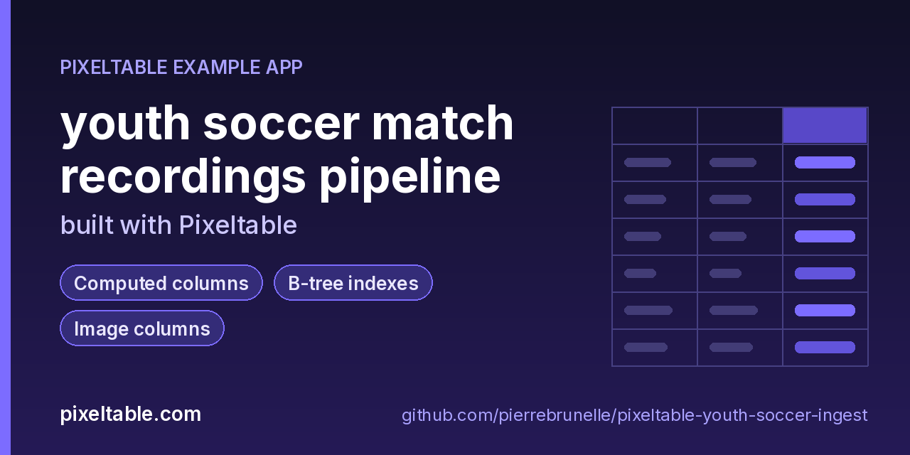

<!-- pixeltable-example-app: 20261106-youth-soccer-ingest -->
# Build a scheduled AI video ingestion pipeline in Python

Point Pixeltable at your match recordings, set time_zone in pixeltable.toml, and run python pipeline.py on a schedule. Kickoffs stay correct across time zones, clips are cut automatically, and a crash mid-batch resumes from a watermark.

**Replaces:** ffmpeg cron scripts + S3 + a job queue

**Use case:** [pixeltable.com/learn/how-to/build-a-video-processing-pipeline](https://pixeltable.com/learn/how-to/build-a-video-processing-pipeline)



[](https://codespaces.new/pierrebrunelle/pixeltable-youth-soccer-ingest?quickstart=1)
[](https://pixeltable.com)
[](https://pypi.org/project/pixeltable/)
[](https://github.com/pixeltable/pixeltable)
[](LICENSE)

A club records U8–U14 matches across fields in different time zones. This scheduled Pixeltable pipeline stores kickoff timestamps in UTC, retrieves them in the club's configured America/Los_Angeles time zone, derives video metadata, and splits each recording into fixed-length highlight clips. A watermarked batch job recovers cleanly after a mid-run crash.

[Pixeltable](https://pixeltable.com) is open-source, Python-native **multimodal AI data infrastructure**: tables, incremental computed columns, UDFs, indexes and serving in one library, running locally or on Pixeltable Cloud.

> ⭐ **Like this example?** Star [pixeltable/pixeltable](https://github.com/pixeltable/pixeltable) on GitHub. It helps other developers find it.

## What this example shows

- **Incremental computed columns** powered by plain Python UDFs (`@pxt.udf`)
- **B-tree indexes** declared on the model (`__indexes__`) back the lookup queries
- **Multimodal media columns** with configurable media destinations
- **Importable UDF module**: UDFs live in `udfs.py`; tables and queries live in `app.py` (Pixeltable resolves UDFs by module path)
- **`pixeltable.toml`** declares a local database and a **Pixeltable Cloud** database, so the same code deploys with `pxt db update`


## What's inside

| File | What it is |
|------|------------|
| `.devcontainer/devcontainer.json` | GitHub Codespaces / Dev Container config: Python 3.12, installs `requirements.txt` |
| `.github/social-preview.png` | Social preview image (1280x640) |
| `CITATION.cff` | Citation metadata (authors, license, release date, keywords) |
| `app.py` | Tables declared as Python classes and `@pxt.query` functions |
| `data/m-u10-hawks-otters.mp4` | Sample data |
| `data/m-u12-comets-wolves.mp4` | Sample data |
| `data/m-u12-jets-lions.mp4` | Sample data |
| `data/m-u14-storm-fc.mp4` | Sample data |
| `data/m-u8-pumas-bees.mp4` | Sample data |
| `data/manifest.json` | Sample data |
| `make_videos.py` | Render tiny youth-soccer field recordings into data/ (no downloads) |
| `pipeline.py` | Part of the youth soccer match recordings API example built with Pixeltable |
| `pixeltable.toml` | Project config: the local database plus a Pixeltable Cloud database (sizing, deploy excludes) |
| `udfs.py` | Pixeltable UDFs (`@pxt.udf`) in their own importable module, imported by `app.py` |
| `requirements.txt` / `pyproject.toml` | Dependencies (`pixeltable>=0.7.23`) |

**Tables**

| Table | Stored columns | Computed columns |
|-------|---------|------------------|
| `matches` | `match_id`, `age_group`, `home`, `away`, `field`, `kickoff`, `video` | `label`, `meta`, `duration`, `band`, `kickoff_day`, `kickoff_hour`, `kickoff_slot`, `kickoff_et`, `kickoff_utc`, `kickoff_et_day` |
| `clips` | - | `clip_seconds` |

## Run in your browser (GitHub Codespaces)

[](https://codespaces.new/pierrebrunelle/pixeltable-youth-soccer-ingest?quickstart=1)

1. Click **Open in GitHub Codespaces** above (or [this link](https://codespaces.new/pierrebrunelle/pixeltable-youth-soccer-ingest?quickstart=1)). The dev container installs Python 3.12 and `pixeltable>=0.7.23` from `requirements.txt`.
2. In the codespace terminal, create the tables, seed them and run the app:

   ```bash
   pxt schema update app.py youth
   pip install -U 'pixeltable[serve]'
   python make_videos.py
   pxt schema update app.py soccer
   python pipeline.py --all-batches
   python pipeline.py --crash-after 2  # recovery drill; then re-run --all-batches
   ```


## Quickstart

Requires Python 3.11+ and `pixeltable>=0.7.23`.

```bash
git clone https://github.com/pierrebrunelle/pixeltable-youth-soccer-ingest.git
cd pixeltable-youth-soccer-ingest
python -m venv .venv && source .venv/bin/activate
pip install -r requirements.txt

# Create the tables in a local catalog directory named `youth`
pxt schema update app.py youth

pip install -U 'pixeltable[serve]'
python make_videos.py
pxt schema update app.py soccer
python pipeline.py --all-batches
python pipeline.py --crash-after 2  # recovery drill; then re-run --all-batches
```

## Deploy to Pixeltable Cloud

The same `app.py` runs on [Pixeltable Cloud](https://pixeltable.com). Sign in (or get a free trial database with `pxt new`), point the second database entry in `pixeltable.toml` at your own database, then deploy:

```bash
pxt login                       # or: export PIXELTABLE_API_KEY=<your-api-key>
# edit pixeltable.toml: name = 'pxt://<your-org>:<your-db>'
pxt db update pxt://<your-org>:<your-db>                 # build the image and upload the project
pxt schema update app.py pxt://<your-org>:<your-db>       # create the tables at the database root (no per-app folder)
```

Keep keys in environment variables or `pxt secret set`, never in code.

## Code walkthrough

**1. Business logic is plain Python, in `udfs.py`.** A `@pxt.udf` function can be used as a column expression. Pixeltable records UDFs by module path (`udfs.match_label`), so they live in their own importable module rather than inline in the app: the daemon, serving workers and Pixeltable Cloud import it again by that path.

```python
# udfs.py
@pxt.udf
def match_label(home: str, away: str, age_group: str) -> str:
    """Compact label like 'U12 · Hawks vs Otters'."""
    h = (home or '?').strip()
    a = (away or '?').strip()
    g = (age_group or '?').strip()
    return f'{g} · {h} vs {a}'
```

**2. Tables are Python classes (`app.py`).** Annotated attributes are stored columns; attributes assigned an expression are **computed columns** (`label`, `meta`, `duration`, `band`, `kickoff_day`, `kickoff_hour`, `kickoff_slot`, `kickoff_et`, `kickoff_utc`, `kickoff_et_day`), evaluated incrementally on every insert or update and recomputed when their inputs change. Indexes live next to the columns.

```python
# app.py
class Matches(TableModel, name='matches', has_default_idxs=False):
    """One youth soccer match recording and its kickoff clock."""

    match_id = pxt.Column(type=pxt.String, primary_key=True)
    age_group: pxt.String
    home: pxt.String
    away: pxt.String
    field: pxt.String
    # Aware or naive; naive uses the configured default time zone on insert.
    kickoff: pxt.Timestamp
    video: pxt.Video

    label = match_label(home, away, age_group)
    meta = pxtf.video.get_metadata(video)
    duration = pxtf.video.get_duration(video)
    band = duration_band(duration)
    # Default-TZ calendar fields (retrieval is always in the configured TZ).
    kickoff_day = pxtf.timestamp.strftime(kickoff, '%a %Y-%m-%d')
    kickoff_hour = pxtf.timestamp.hour(kickoff)
    kickoff_slot = kickoff_hour_local(kickoff_hour)
    # Explicit conversions for clubs that publish in Eastern / UTC.
    kickoff_et = kickoff.astimezone('America/New_York')
    kickoff_utc = kickoff.astimezone('UTC')
    kickoff_et_day = pxtf.timestamp.strftime(kickoff_et, '%a %Y-%m-%d %H:%M %Z')

    __indexes__ = [
        pxt.BtreeIndex(age_group),
        pxt.BtreeIndex(kickoff),
        pxt.BtreeIndex(field),
    ]
```

**3. Queries are functions (`app.py`).** `@pxt.query` wraps a Pixeltable query so it can be called from Python or exposed as a route:

```python
# app.py
@pxt.query
def matches_on_day(day: str):
    """Matches whose local kickoff day equals day (format 'Sat 2026-11-01')."""
    return (
        Matches.where(Matches.kickoff_day == day)
        .order_by(Matches.kickoff)
        .select(
            Matches.match_id,
            Matches.label,
            Matches.field,
            Matches.kickoff,
            Matches.kickoff_et_day,
            Matches.band,
            Matches.duration,
        )
    )
```

## FAQ

**How do kickoff times from Eastern fields show up on a West Coast club clock?**

Set time_zone = "America/Los_Angeles" in pixeltable.toml. Insert aware datetimes (or naive ones in the club zone); Pixeltable stores UTC and retrieves in the default zone. Use .astimezone("America/New_York") when you need Eastern labels.

**What happens if the scheduled job dies mid-batch?**

pipeline.py keeps a next_idx watermark in state.json. Re-running skips match_ids already present and continues from the next batch.

**Do I need a web server?**

No. This is a scheduled-pipeline shape: pxt schema update plus python pipeline.py. No FastAPI router.

## Learn more

- 🌐 Website: https://pixeltable.com
- 📚 Docs: https://docs.pixeltable.com
- 💻 Source: https://github.com/pixeltable/pixeltable (⭐ star it if Pixeltable is useful to you)
- 📦 PyPI: https://pypi.org/project/pixeltable/
- 🎯 Use case: https://pixeltable.com/learn/how-to/build-a-video-processing-pipeline
- 🧩 More example apps: https://pierrebrunelle.github.io/awesome-pixeltable-apps/

**[More Pixeltable example apps →](https://pierrebrunelle.github.io/awesome-pixeltable-apps/)**

---

<sub>Built as part of a daily series of Pixeltable example apps · Pixeltable 0.7.23 · Python, incremental computed columns · Licensed under Apache-2.0.</sub>
